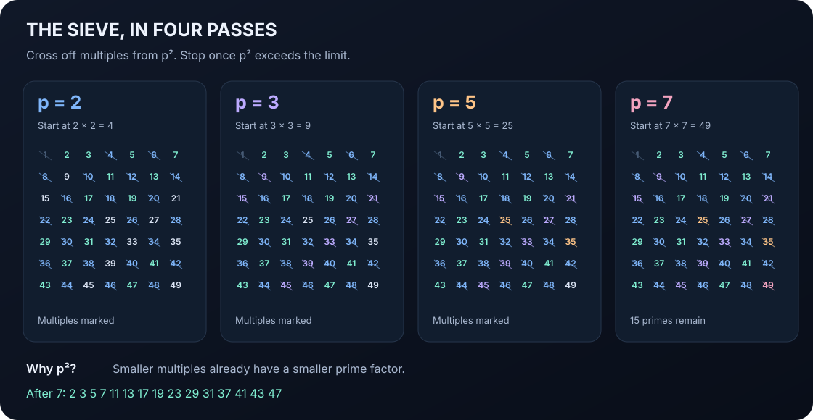

<p align="center">
  
</p>

<p align="center">
  <a href="https://github.com/930turbo/sieve-atlas/actions/workflows/verify.yml"></a>
  
  
  
</p>

# Sieve Atlas

**One ancient algorithm. Thirty languages. Plenty of ways to think.**

A source library for the Sieve of Eratosthenes: small, readable implementations you can run, compare, and borrow from. Explore how the same idea changes through mutable arrays, functional sets, packed bits, lazy scheduling, and segmented windows.

Started as **SoEinH**, a little Haskell experiment. Now a field guide to prime sieving across programming paradigms.

[Browse all languages](docs/LANGUAGES.md) · [Understand the algorithms](docs/ALGORITHMS.md) · [Run & verify](docs/DEVELOPMENT.md) · [Contribute](CONTRIBUTING.md)

## Pick a trail

| If you're curious about… | Start here |
| --- | --- |
| The clearest reference | [Python byte array](implementations/python/sieve.py) |
| Functional purity with fast mutation inside | [Haskell ST array](implementations/haskell/sieve.hs) |
| Explicit ownership and allocation | [C](implementations/c/sieve.c) · [Rust](implementations/rust/sieve.rs) |
| Immutable composite marking | [Elixir](implementations/elixir/sieve.exs) · [Erlang](implementations/erlang/sieve.erl) |
| Less marking memory | [Odd-only Python](variants/odd_only.py) · [Bit-packed JavaScript](variants/bit_packed.mjs) |
| Working in small windows | [Segmented Python](variants/segmented.py) · [Segmented C++](variants/segmented.cpp) |
| Scheduling composites as you go | [Incremental Python](variants/incremental.py) |
| A related algorithm with a different invariant | [Linear / Euler sieve](variants/linear.py) |

## Try it

```sh
python implementations/python/sieve.py 50
# 2 3 5 7 11 13 17 19 23 29 31 37 41 43 47

node implementations/javascript/sieve.mjs 50
runghc implementations/haskell/sieve.hs 50
```

Every program takes an **inclusive upper bound**, defaults to **100**, and prints primes in ascending order, separated by whitespace. Limits below 2 produce an empty line. No interactive prompts, network calls, or data downloads.

The optional Python runner handles build commands and checks which toolchains you have:

```sh
python tools/atlas.py list
python tools/atlas.py run rust 1000
python tools/atlas.py test                 # checks installed runtimes; reports skips
python tools/atlas.py test python javascript --require
```

## The idea, illustrated



Start at 2. Keep each unmarked number, then mark its multiples beginning at its square. Once the next prime's square exceeds the limit, the unmarked numbers are prime. The classic dense-array sieve takes **O(n log log n)** time and **O(n)** marking space. [Why this works →](docs/ALGORITHMS.md)

## Thirty ways to say prime

| | | |
| --- | --- | --- |
| [Bash](implementations/bash/sieve.sh) | [C](implementations/c/sieve.c) | [C++](implementations/cpp/sieve.cpp) |
| [C#](implementations/csharp/Sieve.cs) | [Crystal](implementations/crystal/sieve.cr) | [Dart](implementations/dart/sieve.dart) |
| [Elixir](implementations/elixir/sieve.exs) | [Erlang](implementations/erlang/sieve.erl) | [F#](implementations/fsharp/sieve.fsx) |
| [Fortran](implementations/fortran/sieve.f90) | [Go](implementations/go/sieve.go) | [Haskell](implementations/haskell/sieve.hs) |
| [Java](implementations/java/Sieve.java) | [JavaScript](implementations/javascript/sieve.mjs) | [Julia](implementations/julia/sieve.jl) |
| [Kotlin](implementations/kotlin/Sieve.kt) | [Lua](implementations/lua/sieve.lua) | [Nim](implementations/nim/sieve.nim) |
| [OCaml](implementations/ocaml/sieve.ml) | [Pascal](implementations/pascal/sieve.pas) | [Perl](implementations/perl/sieve.pl) |
| [PHP](implementations/php/sieve.php) | [PowerShell](implementations/powershell/sieve.ps1) | [Python](implementations/python/sieve.py) |
| [R](implementations/r/sieve.R) | [Ruby](implementations/ruby/sieve.rb) | [Rust](implementations/rust/sieve.rs) |
| [Scala](implementations/scala/Sieve.scala) | [Swift](implementations/swift/sieve.swift) | [TypeScript](implementations/typescript/sieve.ts) |

## Small examples, real checks

All 36 entries share a machine-readable [manifest](implementations.json) and a cross-language verification harness. CI builds or runs every entry and compares it with an independent trial-division oracle, including prime squares, inclusive endpoints, negative limits, and seeded random cases. Python tests also cover tiny segment boundaries and known prime counts.

This atlas favors clarity over speed records. Standard libraries only; the language compilers and interpreters are separate prerequisites. Start with limits up to **1,000,000**; shell and immutable-set examples have much higher overhead than compact arrays. [Benchmark honestly →](docs/DEVELOPMENT.md#benchmarks)

The original Haskell filter-chain example is preserved under [historical/](historical/README.md). It generates primes, but its repeated divisibility filtering is different from Eratosthenes' composite marking. [Read the distinction →](docs/ALGORITHMS.md#the-haskell-origin)
